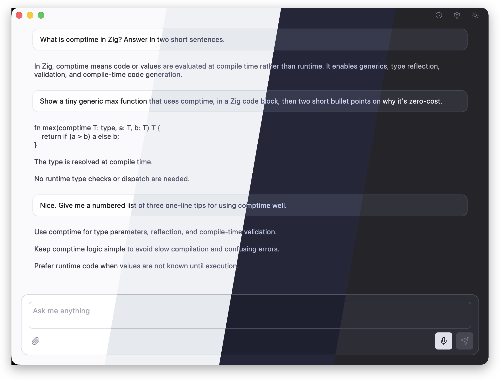

# ChatZig

An AI chat application built with [Gooey](https://github.com/duanebester/gooey) that connects
to both Anthropic's Claude and OpenAI's GPT models.

Inspired by [chat-ai](https://github.com/duanebester/chat-ai) (GPUI/Rust version).

> **ChatZig v0.1.1** · Zig 0.17 · Gooey v0.6.8 · macOS and Linux (Wayland)



## Features

- 💬 Chat with Claude and GPT. Change the model for your next reply in Settings → Chat model.
- The Effort slider sets reasoning effort for chat replies: low, medium (default), high, or xhigh.
- 🎙️ Voice dictation on macOS — record a microphone clip and transcribe it with GPT-Transcribe.
- 🧹 Automatic chat compaction — long conversations are summarized so requests stay bounded, with Anthropic's native compaction where the model supports it (see [`docs/CHAT_COMPACTION.md`](docs/CHAT_COMPACTION.md))
- 💾 Session persistence — conversations are logged to `sessions/*.jsonl` and browsable/restorable from a history panel
- 🎨 Pick Default or Catppuccin in Settings. The toolbar toggles light and dark mode.
- 📜 The transcript follows streamed replies until you scroll up.
- 🔄 Async HTTP requests as Gooey background jobs (non-blocking UI, no polling, zero heap per result), with retry/backoff shared across providers
- ✂️ Stop button cancels the in-flight request
- ⌨️ Enter sends a chat message; Shift+Enter starts a new line. The composer supports IME input,
  a live microphone level meter, and image and PDF attachments with Claude models.

## Runtime benchmark (Gooey v0.6.2)

Historical measurements, not rerun for ChatZig v0.1.1. Captured on a MacBook Pro (M2 Max)
running macOS 26.6, with a ReleaseFast build and a 1000×750 pt window on a 120 Hz display.

| | |
|---|---|
| Binary | 10.4 MiB (ReleaseFast), 9.3 MiB (ReleaseSmall) |
| Launch to first window | ~235 ms warm |
| Memory, idle | ~60 MB physical footprint |
| Memory, 200-message session | ~80 MB physical footprint |
| CPU, idle | 0.3% (no frames are drawn when nothing changes) |
| CPU, streaming a reply | ~5% of one core |
| Frame time, streaming | main thread p50 0.8 ms, p99 2.1 ms |
| Frame time, scrolling | steady 120 fps, main thread p99 1.6 ms |

Memory is `vmmap --summary` physical footprint; frame times come from a
`-Dframe-trace=passive` build of the same commit.

## Prerequisites

1. **Zig 0.17.0** or newer — Install from [ziglang.org](https://ziglang.org/download/). Gooey 0.6 requires it (`minimum_zig_version`).
2. **API keys** — Set `ANTHROPIC_API_KEY` for Claude from the
   [Anthropic Console](https://console.anthropic.com/), or `OPENAI_API_KEY` for GPT and voice
   transcription from the [OpenAI Platform](https://platform.openai.com/). Set both to use both
   providers. You can launch the app and browse local history without keys.

Gooey is pinned to [v0.6.8](https://github.com/duanebester/gooey/releases/tag/v0.6.8) in
`build.zig.zon`. To move to another release:

```bash
zig fetch --save git+https://github.com/duanebester/gooey#v0.6.8
```

**macOS** 14 or newer. **Linux** needs a Wayland compositor and Gooey's system libraries
(no X11):

```bash
# Debian/Ubuntu
sudo apt install libwayland-dev libvulkan-dev libfreetype-dev libharfbuzz-dev \
    libfontconfig-dev libpng-dev libdbus-1-dev
```

Without a Vulkan driver, build with `-Dlinux-backend=wayland_cpu`. Microphone recording
uses CoreAudio and is unavailable on Linux.

## Setup

```bash
# Clone
git clone https://github.com/duanebester/chat-zig
cd chat-zig

# Set the keys for the providers you use
export ANTHROPIC_API_KEY="your-anthropic-key"   # Claude
export OPENAI_API_KEY="your-openai-key"         # GPT and voice transcription

# Build and run
zig build run
zig build run -Dlinux-backend=wayland_cpu   # Linux without a GPU driver

# Run the (offline) unit tests — JSON escaping, response parsing, base64,
# compaction cut arithmetic, session log framing, date formatting, etc.
zig build test
```

## Architecture

ChatZig follows Gooey's app shape: one state struct, a render function, and handlers.

1. **`main.zig`** declares the app: `gooey.App(AppState, layout.render, .{ ... })` owns
   the state, declares the resource budget (`src/limits.zig`) and lists the background
   jobs (`.jobs = &.{ ChatJob, TranscribeJob }`).
2. **AppState** — single source of truth, initialized in place by Gooey and finished in
   `on_init`, which receives `gooey.Init` (`io`, `environ`) and creates the HTTP clients.
   Its handlers are plain methods bound with `cx.on(AppState.sendMessage, .{})`; the ones
   that need the framework take `*gooey.Effects` (spawn a job, scroll, file dialog, quit).
3. **`layout.zig` + `src/components/`** — render UI from the current state.
4. **Jobs** (`src/jobs.zig`) — the Anthropic or OpenAI request and voice transcription
   run as Gooey background jobs. Both clients share the retry/backoff policy in
   `src/http/http.zig`.

### Async result flow

`sendMessage` snapshots the request, including the selected model and effort, in `jobs.exchange` and
starts a `ChatJob` with `effects.spawn`. The job runs on a worker Gooey owns and never
touches `AppState`; each streamed piece it posts arrives at `AppState.onChatResult` on
the main thread in the next drain, and each post wakes the event loop, so nothing polls.
The Stop button calls `effects.cancelJob`, and at quit Gooey cancels and joins every job
before `on_deinit`.

### Resource budget

Gooey reserves every pool at startup from one `gooey.ResourceLimits` value and
panics, naming the field, if a frame needs more. ChatZig uses `.small` with an 8 KiB
job-result payload limit (`src/limits.zig`). The transcript is a `List` whose rows measure their
text with `cx.measureText`, so it builds only the messages in view, and Gooey draws only the
glyphs a scroll box shows: a frame's cost follows the window, not the conversation.
The list is anchored at its end, so a streamed reply stays in view while you are at
the bottom; scrolling up releases it, and sending a message jumps back down.

### Compaction and session persistence

For long conversations, compaction adds a summary and a cut index when assembling the next
request, without rewriting the visible transcript. The live transcript holds the latest 256
messages; older turns remain in the session log. On Claude models that support it, the
summary is Anthropic's native on-demand compaction block (signed, sent back
verbatim, and kept in the session log); other models, or a failed
compaction call, fall back to a client-side summary. See
[`docs/CHAT_COMPACTION.md`](docs/CHAT_COMPACTION.md) for the full design,
including how the cut is computed across ring-buffer overflow and how
sessions are framed and restored from `sessions/*.jsonl`.

## License

MIT
