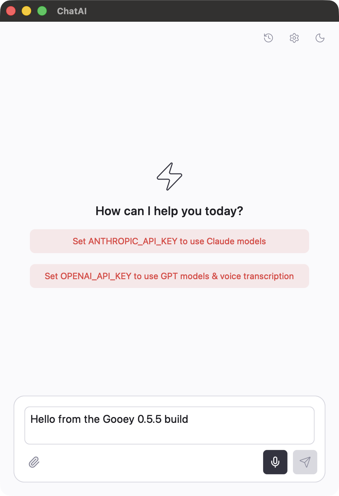
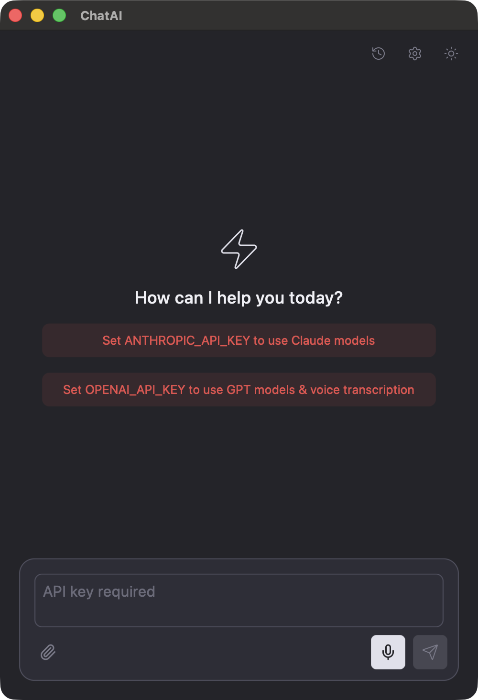

# ChatZig

An AI chat application built with [Gooey](https://github.com/duanebester/gooey) that connects
to both Anthropic's Claude and OpenAI's GPT models.

Inspired by [chat-ai](https://github.com/duanebester/chat-ai) (GPUI/Rust version).

> **Status:** Zig 0.17 / Gooey v0.5.5. Runs on macOS and on Linux (Wayland).
> HTTP runs on `std.Io.concurrent` workers that report back through a
> `std.Io.Queue(T)`; files and session logs use `std.Io.Dir` / `std.Io.File`;
> both the Anthropic and OpenAI paths use the `io`-aware `std.http.Client`.

<table>
  <tr>
    <td></td>
    <td></td>
  </tr>
</table>

## Features

- 💬 Chat with Claude and GPT models, switchable per-conversation from the settings panel
- 🎙️ Voice dictation — record a microphone clip and transcribe it via OpenAI (`gpt-4o-mini-transcribe`)
- 🧹 Automatic chat compaction — long conversations are summarized so requests stay bounded (see [`docs/CHAT_COMPACTION.md`](docs/CHAT_COMPACTION.md))
- 💾 Session persistence — conversations are logged to `sessions/*.jsonl` and browsable/restorable from a history panel
- 🎨 Light/dark theme
- 📜 Streaming replies into a scrolling transcript, bounded to the newest 40 KiB of text per frame
- 🔄 Async HTTP requests on `std.Io.concurrent` workers + `std.Io.Queue` (non-blocking UI, zero heap per result), with retry/backoff shared across providers
- ✂️ Stop button cancels the in-flight request
- ⌨️ Text input (with IME) and send button, file attachments, and a live microphone level meter while recording

## Prerequisites

1. **Zig 0.17.0** or newer — Install from [ziglang.org](https://ziglang.org/download/). Gooey 0.5 requires it (`minimum_zig_version`).
2. **Anthropic API Key** — Get one from [Anthropic Console](https://console.anthropic.com/). Required for Claude models.
3. **OpenAI API Key** (optional) — Get one from [OpenAI Platform](https://platform.openai.com/). Enables GPT chat models and voice dictation transcription; the app runs fine without it, just with those features disabled.

Gooey is pinned to [v0.5.5](https://github.com/duanebester/gooey/releases/tag/v0.5.5) in `build.zig.zon`. To move to another release:

```bash
zig fetch --save git+https://github.com/duanebester/gooey#v0.5.5
```

**macOS** 14 or newer. **Linux** needs a Wayland compositor and Gooey's system libraries
(no X11):

```bash
# Debian/Ubuntu
sudo apt install libwayland-dev libvulkan-dev libfreetype-dev libharfbuzz-dev \
    libfontconfig-dev libpng-dev libdbus-1-dev
```

Without a Vulkan driver, build with `-Dlinux-backend=wayland_cpu`. Microphone recording
uses CoreAudio, so on Linux the record button stays disabled; everything else works.

## Setup

```bash
# Clone
git clone https://github.com/yourusername/chat-zig
cd chat-zig

# Set your API key(s)
export ANTHROPIC_API_KEY="your-key-here"
export OPENAI_API_KEY="your-key-here"   # optional: GPT models + voice dictation

# Build and run
zig build run
zig build run -Dlinux-backend=wayland_cpu   # Linux without a GPU driver

# Run the (offline) unit tests — JSON escaping, response parsing, base64,
# compaction cut arithmetic, session log framing, date formatting, etc.
zig build test
```

## Architecture

ChatZig follows Gooey's app shape: one state struct, a render function, and handlers.

1. **`main(init: std.process.Init)`** — publishes `init.io` and the environment on
   module globals (Gooey hands neither to app code), then calls the generated
   `App.main`. `gooey.App(AppState, layout.render, .{ ... })` owns the state and
   declares the resource budget (`src/limits.zig`).
2. **AppState** — single source of truth, initialized in place by Gooey and finished in
   `on_init` (API keys, HTTP clients, the result queue). Its handlers are plain methods
   bound with `cx.on(AppState.sendMessage, .{})`; the ones that need the framework take
   `*gooey.Effects` (file dialog, theme switch, quit).
3. **`layout.zig` + `src/components/`** — render UI from the current state. `layout.render`
   first calls `s.drainResults()` to apply finished worker output.
4. **Workers** — `sendMessage` starts the Anthropic or OpenAI worker with
   `io.concurrent`, which guarantees it runs beside the UI thread (`io.async` may run it
   inline). Both clients share the retry/backoff policy in `src/http/http.zig`.

### Async result flow

Gooey runs every handler on the main thread and has no public API for background work
or for waking the event loop from another thread. So the workers use `std.Io` directly,
and the UI polls while one is running:

```zig
// sendMessage: the Future lets the Stop button cancel exactly this request.
self.pending_request = io.concurrent(httpWorker, .{ io, &self.http_client.?, self, &self.result_queue }) catch ...;

// httpWorker, off the main thread: stage bytes, then publish a high-water mark.
// `putOne` is the happens-before edge that makes the staged bytes visible.
queue.putOne(io, .{ .chat_delta = .{ .cumulative_len = new_len } }) catch ...;

// layout.render, on the main thread, every frame while a worker is in flight:
s.drainResults(); // non-blocking `result_queue.get(io, &buf, 0)`
if (s.workerInFlight()) cx.requestRenderAfter(state.WORKER_POLL_MS); // ~30 Hz
```

When no worker is running the app requests no frames and sits idle.

### Resource budget

Gooey 0.5 reserves every pool at startup from one `gooey.ResourceLimits` value and
panics, naming the field, if a frame needs more. ChatZig uses `.small` with these
overrides (`src/limits.zig`):

| Field | `.small` | ChatZig | Why |
| --- | ---: | ---: | --- |
| `paint.glyph_count_frame_max` | 4,096 | 49,152 | The transcript draws up to 40 KiB of message text per frame, plus chrome |
| `records.paint_record_count_frame_max` | 8,192 | 65,536 | One paint record per glyph, beside quads and icons |
| `build.text_bytes_frame_max` | 64 KiB | 64 KiB | Asserted to cover the 40 KiB transcript plus 8 KiB of chrome |
| `text.glyph_cache_count_max` | 1,024 | 4,096 | Replies in other scripts draw many distinct glyphs |
| `text.shaped_run_count_max` | 128 | 512 | Keeps the visible transcript's shaped runs cached between frames |

Gooey emits every glyph inside a scroll box each frame, so the transcript draws the
newest messages that fit in 40 KiB (always the newest one, which is at most 32 KiB)
and notes how many earlier ones it skipped. Those are still in history and still sent.

### Compaction and session persistence

Long conversations are summarized rather than truncated: `AppState.messages`
is never mutated, and a small summary + cut index is layered on top only
when assembling the next request. See
[`docs/CHAT_COMPACTION.md`](docs/CHAT_COMPACTION.md) for the full design,
including how the cut is computed across ring-buffer overflow and how
sessions are framed and restored from `sessions/*.jsonl`.

## License

MIT
